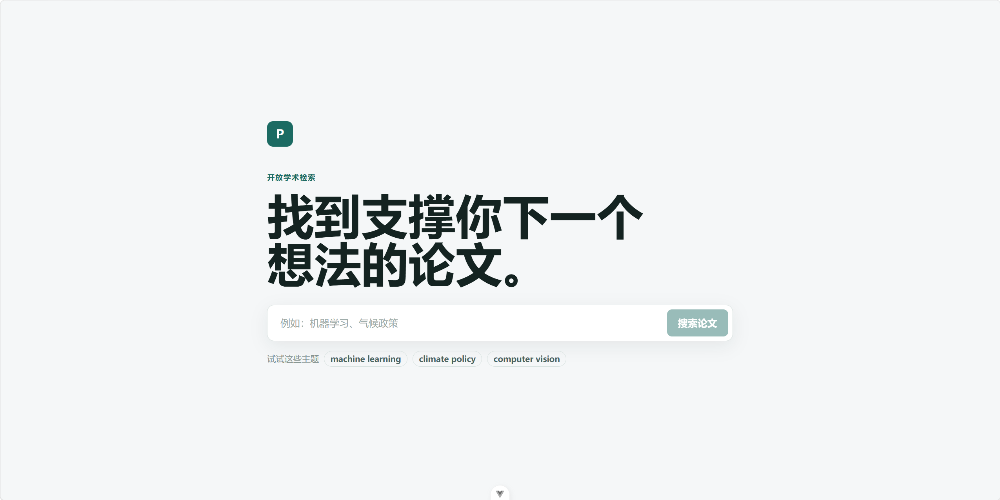
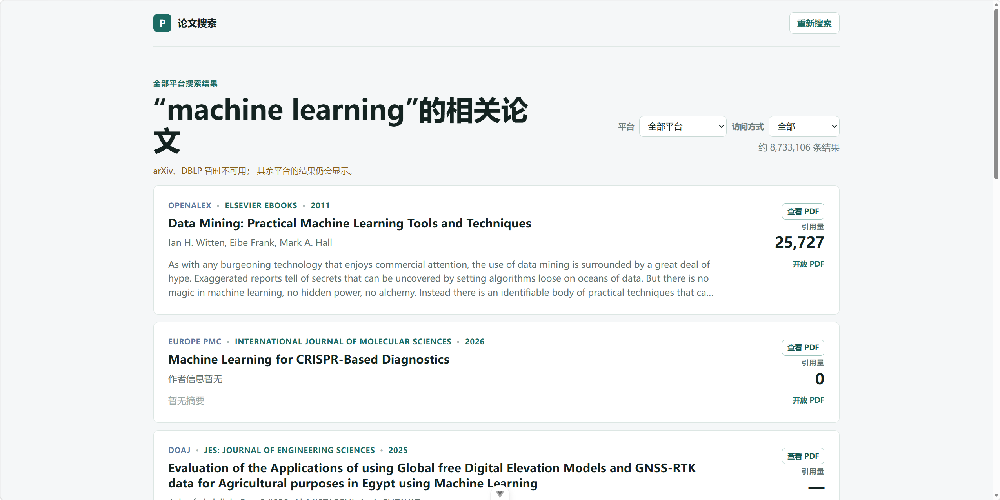

# paper-fetcher｜多平台论文搜索系统

一个使用 Vue 3 和 FastAPI 构建的多平台学术论文搜索项目。用户输入关键词后，系统会从多个公开学术信息来源获取结果，将不同格式的数据转换为统一的论文结构，并在同一页面中展示、筛选和跳转至论文详情页或 PDF。


## 项目功能

- 输入中英文关键词搜索论文。
- 支持选择全部平台或单独平台搜索。
- 将各平台返回的不同 JSON/XML 数据统一为 `Paper` 数据结构。
- 展示标题、作者、年份、来源、摘要、DOI、引用量、详情页和 PDF 链接。
- 支持按访问能力筛选：全部、开放获取、有 PDF、仅详情页。
- 多平台搜索时并行请求、去重，并优先展示可公开访问或有 PDF 的论文。
- 后端记录请求、网络、解析和平台错误日志，便于排查问题。

## 界面预览

### 搜索页



### 结果页



## 已接入的平台

| 平台 | 类型 | 覆盖方向 | 返回格式 | 官网与 API 文档 | 当前说明 |
|---|---|---|---|---|---|
| OpenAlex | 开放学术知识图谱 | 全学科 | JSON | [官网](https://openalex.org/) · [API 文档](https://docs.openalex.org/) | 已实现适配器；当前网络环境可能无法连接 |
| Crossref | DOI 元数据服务 | 全学科正式出版物 | JSON | [官网](https://www.crossref.org/) · [REST API 文档](https://www.crossref.org/documentation/retrieve-metadata/rest-api/) | 可用于题目、作者、期刊、DOI 等元数据 |
| arXiv | 开放预印本仓库 | 计算机、数学、物理等 | Atom XML | [官网](https://arxiv.org/) · [API 用户手册](https://info.arxiv.org/help/api/user-manual.html) | 摘要和 PDF 链接较完整 |
| Europe PMC | 生物医学文献平台 | 医学、生命科学 | JSON | [官网](https://europepmc.org/) · [REST Web Service 文档](https://europepmc.org/RestfulWebService) | 可获得部分开放获取与 PDF 信息 |
| PubMed | 生物医学文献索引 | 医学、生命科学 | JSON + XML | [官网](https://pubmed.ncbi.nlm.nih.gov/) · [NCBI E-utilities 文档](https://www.ncbi.nlm.nih.gov/books/NBK25501/) | 通过 PMID 检索；有 PMC ID 时通常可访问全文 |
| DBLP | 计算机科学书目库 | 计算机科学 | JSON | [官网](https://dblp.org/) · [API 说明](https://dblp.org/faq/13501473.html) | 适合会议、期刊、作者与 DOI 信息 |
| DOAJ | 开放获取期刊目录 | 全学科 | JSON | [官网](https://doaj.org/) · [API 文档](https://doaj.org/api/v3/docs) | 已实现适配器；当前可能被 Cloudflare 人机验证拦截 |

说明：平台是搜索数据来自哪里；来源（`source`）是论文本身发表的期刊、会议或仓库。例如论文可由 OpenAlex 搜到，但来源是 Nature，详情页位于出版社网站。

### 各平台 Postman 测试接口

以下接口均为关键词 `machine learning`、返回 5 条数据的示例。将整条 URL 复制到 Postman，使用 `GET` 方法发送即可。

| 平台 | 测试接口 |
|---|---|
| OpenAlex | `https://api.openalex.org/works?search=machine%20learning&per-page=5` |
| Crossref | `https://api.crossref.org/works?query.bibliographic=machine%20learning&rows=5` |
| arXiv | `https://export.arxiv.org/api/query?search_query=all:machine_learning&start=0&max_results=5` |
| Europe PMC | `https://www.ebi.ac.uk/europepmc/webservices/rest/search?query=machine%20learning&format=json&page=1&pageSize=5&resultType=core` |
| PubMed（第一步搜索 PMID） | `https://eutils.ncbi.nlm.nih.gov/entrez/eutils/esearch.fcgi?db=pubmed&term=machine%20learning&retmode=json&retmax=5` |
| DBLP | `https://dblp.org/search/publ/api?q=machine%20learning&format=json&h=5` |
| DOAJ | `https://doaj.org/api/search/articles/machine%20learning?page=1&pageSize=5` |

> PubMed 返回的是 PMID 列表，需要再调用 `efetch.fcgi` 获取论文详细 XML；项目后端已完成这两步请求。DOAJ 在当前网络环境中可能返回 Cloudflare 验证页面，OpenAlex 当前也可能无法连接。

## 技术栈

### 前端

- Vue 3
- TypeScript
- Vue Router
- Vite

### 后端

- Python
- FastAPI
- Uvicorn
- httpx
- Pydantic Settings

## 目录结构

```text
.
├── backend/                         # FastAPI 后端
│   ├── app/
│   │   ├── api/routes/papers.py     # 统一论文搜索接口
│   │   ├── core/                    # 配置、HTTP 客户端、日志配置
│   │   ├── schemas/paper.py         # Paper 等统一数据模型
│   │   ├── sources/                 # 各学术平台适配器
│   │   └── utils/                   # JSON/XML/文本解析工具
│   └── requirements.txt
├── frontend/
│   └── paper-search/                # Vue 前端项目
│       └── src/
│           ├── services/api.ts      # 调用后端 API
│           ├── types/paper.ts       # 前端论文类型
│           └── views/               # 搜索页和结果页
└── README.md
```

## 本地运行

### 1. 启动后端

```powershell
cd backend
python -m venv .venv
.\.venv\Scripts\Activate.ps1
pip install -r requirements.txt
python -m app.main
```

后端默认运行在 `http://127.0.0.1:8080`。

可访问 Swagger API 文档：`http://127.0.0.1:8080/docs`

### 2. 启动前端

```powershell
cd frontend\paper-search
npm install
npm run dev
```

前端默认运行在 `http://localhost:5173`，开发环境通过 Vite 代理将 `/api` 请求转发到后端 `8080` 端口。

## 后端接口示例

```text
GET /api/papers/search?q=machine%20learning&platform=all&page=1&pageSize=10
```

参数：

| 参数 | 说明 |
|---|---|
| `q` | 搜索关键词，必填 |
| `platform` | `all` 或具体平台：`openalex`、`crossref`、`arxiv`、`europepmc`、`pubmed`、`dblp`、`doaj` |
| `page` | 页码，从 1 开始 |
| `pageSize` | 每页数量，范围为 1–50 |

统一返回中的单篇论文示例：

```json
{
  "id": "arxiv:2306.04338v1",
  "platform": "arxiv",
  "title": "Changing Data Sources in the Age of Machine Learning for Official Statistics",
  "year": 2023,
  "authors": ["Cedric De Boom", "Michael Reusens"],
  "abstract": "...",
  "source": "arXiv · stat.ML",
  "doi": null,
  "url": "https://arxiv.org/abs/2306.04338v1",
  "citationCount": null,
  "isOpenAccess": true,
  "pdfUrl": "https://arxiv.org/pdf/2306.04338v1",
  "accessType": "openPdf"
}
```

## 可选环境变量

项目不创建 `.env` 文件也可以正常启动和调用现有公开 API。只有需要填写联系邮箱、使用某个平台 API Key，或修改端口等配置时，才需要复制 `backend/.env.example` 为 `backend/.env`。

```env
OPENALEX_MAILTO=your_email@example.com
OPENALEX_API_KEY=
CROSSREF_MAILTO=your_email@example.com
NCBI_EMAIL=your_email@example.com
NCBI_API_KEY=
```

- 所有字段都是可选的；保持为空时，项目仍会使用公开接口进行搜索。
- OpenAlex、Crossref 和 PubMed/NCBI 建议在长期或高频使用时填写真实联系邮箱，以符合平台的使用建议。
- `OPENALEX_API_KEY` 与 `NCBI_API_KEY` 仅在你已经申请到对应 Key 时填写，可提高部分平台的请求额度。
- `.env` 可能包含个人配置，已被 Git 忽略，不应提交。

## 日志

后端启动后，日志会同时显示在终端并写入：

```text
backend/logs/paper-search.log
```

日志包含网络请求、超时、HTTP 错误和数据解析问题。日志目录已写入 `.gitignore`，不会被提交。

## 已知限制

- 不同平台的收录范围、相关性排序、总数与引用量统计口径不同。
- 多平台 `all` 搜索的总数是各平台总数相加，属于近似值；同一论文可能被多个平台收录。
- 当前每个平台只请求当前页数据，因此不能实现真正的“全库引用量排序”。
- Crossref、DBLP、PubMed 等平台常没有直接 PDF 或摘要。
- OpenAlex 在当前网络环境下可能无法连接。
- DOAJ 当前可能返回 Cloudflare 人机验证页面，不适合实时服务器端调用。
- 知网、万方、维普等国内大型数据库通常需要机构或商业授权，项目不会绕过登录、验证码或访问限制。

## 后续计划

- 在获得官方授权的前提下接入中文学术平台。
- 优化来源统计与开放全文优先展示策略。
- 为失败平台增加更友好的前端提示与重试策略。
- 如未来需要本地全文检索、收藏、历史记录或全局排序，再引入数据库。
